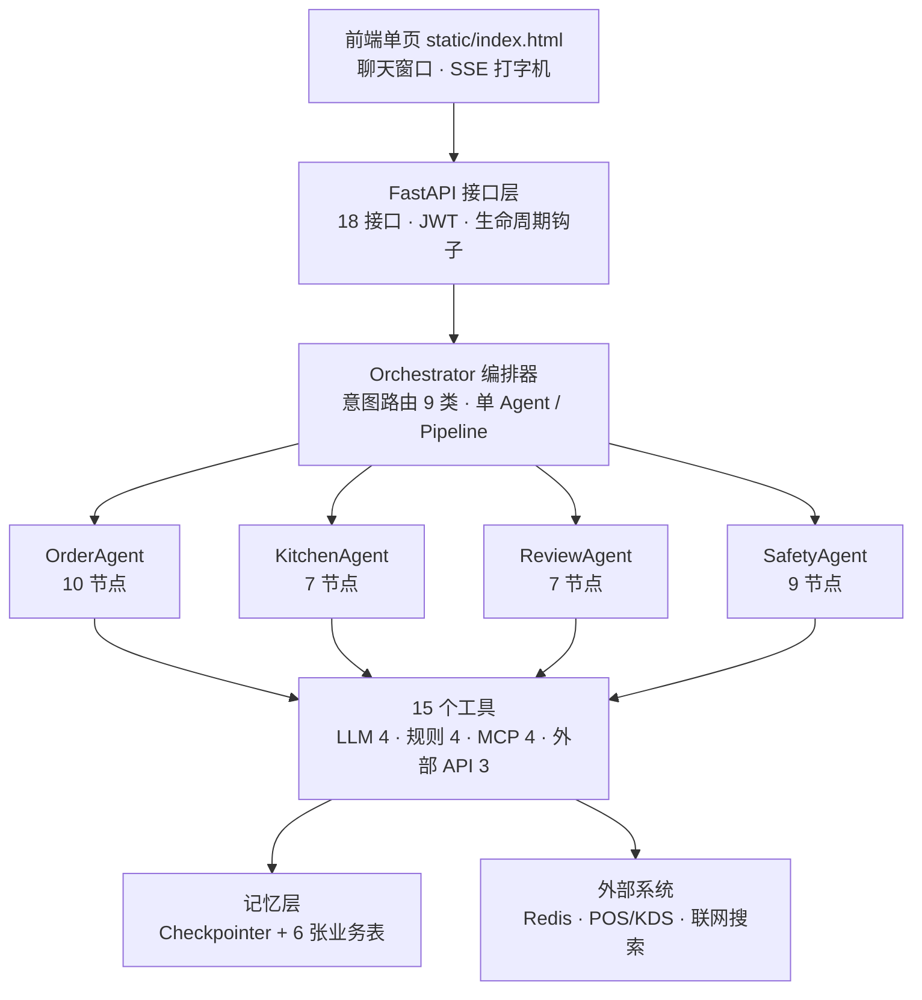
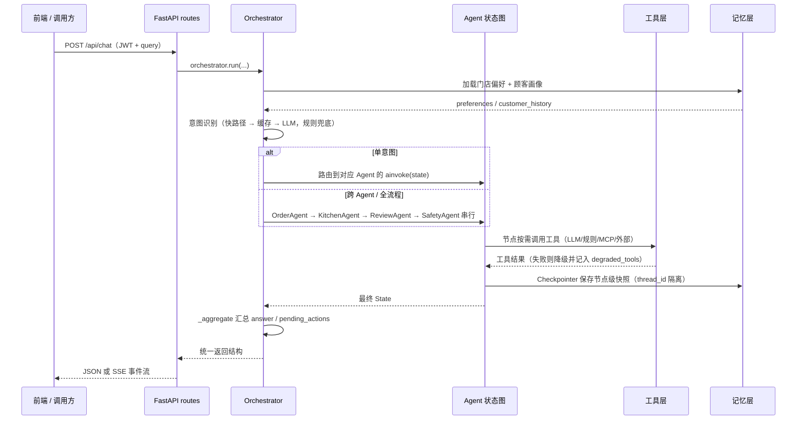

# FoodAgent · AI 智能餐饮 Agent 系统

> 基于 **LangGraph 状态图 + Orchestrator 编排器** 的连锁餐饮智能助手。
> **4 个专业 Agent、33 个节点、15 个分层工具、9 类餐饮意图**、三层记忆架构，
> 完整覆盖「**点餐 → 后厨 → 评价 → 食安问答**」餐饮业务全链路。
> 知识层为**内置知识库**（法规要点 + 菜品营养 + 过敏原规范），零外部依赖可运行；
> 接口按可插拔设计，换外部 RAG/向量库只需改 `tools/mcp_tools.py` 的数据源。

> **新手先读**：想快速搞懂「一次请求在系统里怎么流动、代码在哪」，直接看 **[docs/ARCHITECTURE.md](docs/ARCHITECTURE.md)**（含完整流程图与代码索引）。

---

## 一、系统概览

| 维度 | 内容 |
|------|------|
| 架构 | LangGraph StateGraph + Orchestrator 编排器（意图路由 / 单 Agent 直达 / 多 Agent Pipeline） |
| Agent | **OrderAgent(10 节点)** · **KitchenAgent(7 节点)** · **ReviewAgent(7 节点)** · **SafetyAgent(9 节点)** = 共 **33 节点** |
| 工具 | **15 个** = LLM 工具 4 + 规则引擎 4 + MCP 工具 4 + 外部 API 封装 3 |
| 意图 | **9 类**：菜品推荐 / 智能点餐 / 过敏原查询 / 后厨调度 / 库存检查 / 评价分析 / 改进建议 / 食安法规问答 / 营养健康问答 |
| 记忆 | **三层**：Checkpointer 短期记忆 + PostgreSQL 长期记忆 + 餐饮行业特定记忆（门店偏好/顾客画像/食材消耗） |
| 隔离 | **tenant_id + user_id 双层隔离** |
| 合规 | 过敏原食品安全留痕（保留 **3 年**备查）、Human-in-the-Loop（interrupt 人工确认） |
| 交互 | FastAPI + SSE 流式输出 + JWT 认证，**18 个 RESTful 接口** |
| 缓存 | Redis（db2）热点缓存，未启用时降级为进程内字典 |

### 顶层架构



---

## 二、业务能力

### 4 个 Agent 与 15 个工具

| Agent | 节点数 | 处理意图 | 核心工具 |
|-------|--------|----------|----------|
| **OrderAgent** 智能点餐 | 10 | dish_recommend / smart_order / allergen_query | `llm_classify_intent`(需求解析) · `llm_recommend_dishes`(菜品推荐) · `allergen_detection`(过敏原) · `price_calculation`(价格) · `search_menu_knowledge`(菜品检索) · `query_nutrition`(营养) |
| **KitchenAgent** 后厨调度 | 7 | kitchen_dispatch / inventory_check | `inventory_calculation`(库存核算) · `priority_calculation`(优先级) · `get_ingredient_inventory`(库存查询) · `get_order_detail`(订单详情) |
| **ReviewAgent** 评价分析 | 7 | review_analysis / improvement_advice | `llm_sentiment_analysis`(情感分析) · `llm_generate_improvement`(改进建议) · `query_food_safety_law`(食安法规) · `get_review_data`(评价拉取) |
| **SafetyAgent** 食安问答 | 9 | food_safety_query / nutrition_query | `query_food_safety_law`(法规检索) · `query_nutrition`(营养查询) · `web_search`(联网兜底) |

**15 个工具完整清单**（数据源：`tools/registry.py`，`GET /api/tools` 可实时查看）

| 类别 | 工具 | 归属 |
|------|------|------|
| **LLM 工具（4）** | `llm_classify_intent` · `llm_recommend_dishes` · `llm_sentiment_analysis` · `llm_generate_improvement` | Order ×2 / Review ×2 |
| **规则引擎（4）** | `allergen_detection` · `price_calculation` · `inventory_calculation` · `priority_calculation` | Order ×2 / Kitchen ×2 |
| **MCP 工具（4）** | `search_menu_knowledge` · `query_food_safety_law` · `query_nutrition` · `web_search` | Order ×2 / Review ×2 / Safety ×3 |
| **外部 API（3）** | `get_order_detail` · `get_ingredient_inventory` · `get_review_data` | Order+Kitchen / Kitchen / Review |

> 关键设计：**过敏原检测绝不交给 LLM**——由规则引擎做精确交集判定，避免幻觉导致的食品安全事故。
> 四类工具的分工逻辑：LLM 负责「不精确但灵活」的理解类任务；规则引擎负责「必须 100% 准确」的计算类任务；
> MCP 负责知识检索；外部 API 负责对接甲方既有系统（POS/KDS/评价平台）。

### 意图 → Agent 路由表

| 意图 | 归属 Agent | 典型输入 |
|------|-----------|----------|
| `dish_recommend` 菜品推荐 | OrderAgent | "推荐几个招牌菜" |
| `smart_order` 智能点餐 | OrderAgent | "帮我点一份不辣的牛肉面" |
| `allergen_query` 过敏原查询 | OrderAgent | "这道菜含不含花生" |
| `kitchen_dispatch` 后厨调度 | KitchenAgent | "后厨现在几单，帮我排顺序" |
| `inventory_check` 库存检查 | KitchenAgent | "牛肉还剩多少，够不够" |
| `review_analysis` 评价分析 | ReviewAgent | "分析一下本周差评" |
| `improvement_advice` 改进建议 | ReviewAgent | "怎么提升出餐速度" |
| `food_safety_query` 食安法规问答 | SafetyAgent | "凉菜间消毒有什么标准" |
| `nutrition_query` 营养健康问答 | SafetyAgent | "这道菜多少卡路里" |

命中跨多个 Agent 的意图（或输入含"全流程/从推荐到/一条龙"）时，Orchestrator 自动切 **Pipeline 模式**，按 `Order → Kitchen → Review → Safety` 顺序串联，前一阶段的产出作为后一阶段的输入。也可通过 `agent_sequence` 参数显式指定阶段与顺序（如只跑 `["kitchen","review"]`）。

---

## 三、快速开始

### 3.1 环境要求

- Python **3.10+**
- 可选但推荐：PostgreSQL 14+（启用长期记忆与 Checkpointer）、Redis 7+（热点缓存）
- 不依赖外部服务：食安法规与营养知识为内置知识库，单机启动即可完整问答
- 任一可选依赖缺失都会**自动降级**，功能不中断（见第九章）

### 3.2 安装与运行

```bash
# 1) 进入项目目录
cd D:\heima\FoodAgent

# 2) 准备 Python 环境（任选其一）
python -m venv venv && venv\Scripts\activate     # 方案 A：venv
conda activate system                            # 方案 B：用已有 conda 环境

# 3) 安装依赖
pip install -r requirements.txt

# 4) 配置环境变量（复制模板并填入 DeepSeek API Key）
copy .env.example .env
# 编辑 .env：LLM_API_KEY=sk-xxxxxx

# 5) 环境自检（检查 Python 版本 / 依赖 / 配置 / 密钥）
python main.py --check

# 6) 启动服务
python main.py
```

启动后访问：

| 地址 | 说明 |
|------|------|
| http://127.0.0.1:8090/ | 前端聊天界面 |
| http://127.0.0.1:8090/docs | Swagger 接口文档 |
| http://127.0.0.1:8090/redoc | ReDoc 接口文档 |
| http://127.0.0.1:8090/api/health | 健康检查（含依赖状态） |

### 3.3 演示账号

| 工号 | 密码 | 角色 | 门店 |
|------|------|------|------|
| `waiter_01` | 123456 | 服务员 | store_001 |
| `waiter_02` | 123456 | 服务员 | store_002 |
| `kitchen_01` | 123456 | 后厨主管 | store_001 |
| `manager_01` | 123456 | 店长 | store_001 |

### 3.4 基础设施（本机已部署）

```bash
# PostgreSQL：长期记忆 + Checkpointer（宿主 5432）
docker start foodagent_postgres

# Redis：热点缓存（宿主 6379，密码 123456，FoodAgent 用 db2）
docker start redis

# 验证
docker ps --filter name=foodagent_postgres --filter name=redis
```

两个容器均为 `restart unless-stopped`，Docker Desktop 启动后会自动拉起，通常无需手动处理。

### 3.5 其他启动方式

```bash
python run_cli.py                                        # 终端交互模式（调试 Agent 逻辑）
python main.py --port 9000                               # 自定义端口
python main.py --reload                                  # 热重载（开发）
uvicorn api.app:app --host 0.0.0.0 --port 8090            # 直接用 uvicorn
docker compose -f docs/deploy/docker-compose.yml up -d    # Docker 一键编排（应用也容器化）
```

### 3.6 验证与压测脚本

| 脚本 | 用途 |
|------|------|
| `python main.py --check` | 环境自检（Python/依赖/配置/密钥） |
| `python scripts/selfcheck.py` | 一键验证项目完整性（6 个维度） |
| `python scripts/check_graph_structure.py` | 四个 Agent 状态图结构校验（无出边 / 不可达 / 无法收敛） |
| `python scripts/test_api.py` | 18 个接口 HTTP 冒烟测试 |
| `python scripts/verify_compliance.py` | 食安合规留痕链路验证 |
| `python scripts/verify_fsm.py` | 订单状态机流转验证 |
| `python scripts/verify_observability.py` | 可观测性（trace/metrics/cache）验证 |
| `python scripts/purge_expired.py --dry-run` | 记忆过期清理预演（挂定时任务用） |
| `locust -f scripts/locustfile.py` | 并发压测（模拟高峰期多桌下单） |

---

## 四、目录结构

```
FoodAgent/
├── main.py                     # 统一启动入口（含环境自检）
├── app.py                      # 根目录薄封装（兼容 python app.py）
├── run_cli.py                  # 终端交互模式
├── config.ini                  # 配置文件（非敏感项）
├── .env / .env.example         # 环境变量（密钥，.env 不入库）
├── requirements.txt
├── Dockerfile
│
├── base/                       # 基础设施层
│   ├── config.py               # 配置唯一来源（.env > config.ini > fallback）
│   ├── logger.py               # 统一日志（控制台 + logs/app.log）
│   └── exceptions.py           # 异常体系 + 重试装饰器 + 降级工具
│
├── tools/                      # 工具层（15 个，四类分层）
│   ├── llm_client.py           # DeepSeek 客户端（重试 + 脱敏 + JSON 兜底 + 备用模型）
│   ├── llm_tools.py            # ① LLM 工具 4 个（含规则降级分支）
│   ├── rule_tools.py           # ② 规则引擎 4 个（纯计算，100% 准确）
│   ├── mcp_tools.py            # ③ MCP 工具 4 个（知识库检索：内置知识优先，可换外部源）
│   ├── external_api.py         # ④ 外部 API 封装 3 个（POS/KDS/评价，未接入返回 Mock）
│   ├── safety_knowledge.py     # 内置食安法规要点 + 过敏原管理规范
│   ├── menu_data.py            # 内置菜品库与营养表
│   ├── menu_seed.py            # 菜品数据播种
│   ├── registry.py             # 工具注册表（断言 15 个，/api/tools 数据源）
│   ├── reranker.py             # 轻量精排（词法打分 + 0.75 置信阈值，无模型依赖）
│   ├── cache.py                # Redis 缓存（降级：进程内字典）
│   ├── metrics.py              # Prometheus 指标（未启用时全部 no-op）
│   └── tracing.py              # LangSmith 追踪（未启用时退化为恒等装饰器）
│
├── prompts/
│   └── templates.py            # 全部 Prompt 模板（结构化输出优先）
│
├── memory/                     # 记忆层（三层记忆的两层落在这里）
│   ├── schemas.py              # 6 张业务表 DDL（表结构唯一来源）
│   ├── store.py                # 长期记忆（PostgresStore ↔ FileStore 降级）
│   ├── checkpointer.py         # 短期记忆（PostgresSaver ↔ MemorySaver ↔ None）
│   └── order_state.py          # 订单状态机常量与流转规则
│
├── agents/                     # Agent 层
│   ├── state.py                # 全局 State 定义（initial_state）
│   ├── base_agent.py           # 基类：图装配 + 顺序执行器降级 + 终态校验
│   ├── orchestrator.py         # 编排器（意图路由 + Pipeline + 上下文传递）
│   ├── order/                  # OrderAgent 子包
│   │   ├── state.py            #   专属 State
│   │   ├── prompts.py          #   节点级提示词
│   │   ├── nodes.py            #   10 个节点函数（纯函数：state → 增量）
│   │   └── graph.py            #   图装配（节点表 + 边表）
│   ├── kitchen/                # KitchenAgent 子包（结构同上，7 节点）
│   ├── review/                 # ReviewAgent 子包（结构同上，7 节点）
│   ├── safety/                 # SafetyAgent 子包（结构同上，9 节点，食安问答 RAG）
│   ├── order_agent.py          # 兼容 re-export（指向 order/graph.py）
│   ├── kitchen_agent.py        # 兼容 re-export
│   ├── review_agent.py         # 兼容 re-export
│   └── safety_agent.py         # 兼容 re-export
│
├── api/                        # 接口层
│   ├── app.py                  # FastAPI 装配（生命周期 + 静态挂载 + 连接池释放）
│   ├── routes.py               # 18 个 RESTful 接口 + SSE 流式
│   ├── models.py               # Pydantic 请求/响应模型
│   └── auth.py                 # JWT 认证（PBKDF2 加盐哈希）
│
├── static/index.html           # 前端单页（聊天窗口 + SSE 打字机效果）
├── scripts/                    # 验证 / 压测 / 运维脚本
├── docs/                       # 文档
│   ├── ARCHITECTURE.md         # ★ 架构与流程详解（新手先读这本）
│   ├── REQUIREMENTS.md         # 需求文档
│   ├── OBSERVABILITY.md        # 可观测性（LangSmith/Redis/Prometheus/Locust）
│   ├── TOOL_NAME_MAPPING.md    # 工具名称映射
│   └── deploy/                 # schema.sql + docker-compose.yml + k8s
├── data/                       # 运行时数据（长期记忆 JSON 降级存储）
└── logs/                       # 运行日志
```

> `agents/order|kitchen|review|safety` 是重构后的**分层子包**（state / prompts / nodes / graph），
> 外层 `*_agent.py` 只做向后兼容 re-export，老代码 `from agents.order_agent import order_agent` 不受影响。

---

## 五、一次请求的完整链路



四个关键细节：

1. **State 是 dict，节点只返回增量**。LangGraph 对 dict schema 默认「整状态替换」，所以
   `BaseAgent._wrap_node` 会把节点的增量合并回完整 State —— 这是条件边能读到数据、不死循环的前提。
2. **工具失败不抛给用户**。失败的工具名进 `degraded_tools`，节点改用规则/内置知识库继续跑。
3. **Checkpointer 按 thread_id 落库**。多轮对话、断点续传都靠它；Pipeline 模式会把 thread_id
   加上阶段后缀（`{thread_id}_{order|kitchen|review}`）避免互相覆盖。
4. **Pipeline 模式下不中断**。HTTP 请求无法挂起等人工，因此打开 `pipeline_mode`，
   需要确认的事项累积到 `pending_actions`，流水线跑完统一提示前端。

---

## 六、知识层：内置优先、接口可插拔

食安与营养知识**内置在本项目内**，不依赖任何外部服务，因此单机 `python main.py` 即可完整演示：

| 知识源 | 内容 | 被谁用 |
|--------|------|--------|
| `tools/safety_knowledge.py` | 食品安全法规要点（GB 31654 / GB 7718 / GB 31621 / 食品安全法 / 留样规范等）+ 过敏原管理规范 | SafetyAgent 法规检索、ReviewAgent 差评合规核查 |
| `tools/menu_data.py` | 菜品库（配料/过敏原/价格）+ 营养成分表 | OrderAgent 推荐与营养、SafetyAgent 营养问答、规则引擎过敏原判定 |
| `tools/registry.py` 中的 MCP 4 工具 | `search_menu_knowledge` / `query_food_safety_law` / `query_nutrition` / `web_search` | 全部 Agent |

**为什么这么设计**：知识检索是对外依赖里最不稳定的一环（外部服务挂了整个问答就废）。
所以把它做成「**内置知识兜底 + 统一接口形状**」：

- 检索失败 → 降级为关键词匹配；联网失败 → 返回缓存（TTL 24h）；仍失败 → 内置静态知识 + 友好提示；
- 要换成外部 RAG / 向量库（Milvus 等），**只改这 4 个函数的数据源**，
  Agent 节点、图结构、接口层一行都不用动。

```python
# tools/mcp_tools.py —— 换知识源的唯一改动点
async def query_food_safety_law(query: str, ...): ...
async def query_nutrition(query: str, ...): ...
async def search_menu_knowledge(query: str, top_k: int = 5, ...): ...
async def web_search(query: str, max_results: int = 5): ...
```

---

## 七、18 个 RESTful 接口

| # | 方法 | 路径 | 说明 |
|---|------|------|------|
| ① | POST | `/api/auth/login` | 登录（返回 JWT） |
| ② | GET | `/api/auth/me` | 当前用户信息 |
| ③ | POST | `/api/tasks` | 创建任务（返回 thread_id） |
| ④ | POST | `/api/chat` | 对话（非流式） |
| ⑤ | GET | `/api/chat/stream` | 对话（**SSE 流式**，打字机效果） |
| ⑥ | DELETE | `/api/chat/history/{thread_id}` | 清除任务历史（真正调用 Checkpointer 的 `delete_thread`；无持久化时如实返回未清除） |
| ⑦ | POST | `/api/orders` | 创建订单 |
| ⑧ | GET | `/api/orders/{order_id}` | 查询订单详情 |
| ⑨ | GET | `/api/orders` | 订单列表 |
| ⑩ | GET | `/api/kitchen/pending` | 待处理订单（后厨） |
| ⑪ | POST | `/api/kitchen/schedule` | 生成排产方案 |
| ⑫ | POST | `/api/reviews/analyze` | 评价分析 |
| ⑬ | GET | `/api/reviews/history` | 评价分析历史 |
| ⑭ | GET | `/api/memory/preferences` | 查询门店偏好 |
| ⑮ | PUT | `/api/memory/preferences` | 更新门店偏好 |
| ⑯ | GET | `/api/memory/customer/{customer_id}` | 查询顾客画像 |
| ⑰ | PUT | `/api/memory/customer/{customer_id}` | 更新顾客画像 |
| ⑱ | GET | `/api/agents` | Agent 清单与结构 |

**辅助接口**：`/api/tools`（15 工具清单）、`/api/intents`（9 意图）、`/api/config`（前端配置）、`/api/health`（健康检查，含主/备模型状态）、`/api/endpoints`（接口自文档化）。

访问 http://127.0.0.1:8090/api/endpoints 可随时查看完整登记。

---

## 八、三层记忆与双层隔离

| 层 | 载体 | 隔离键 | 作用 |
|----|------|--------|------|
| 短期记忆 | LangGraph Checkpointer（PG / 内存） | `thread_id` | 多轮对话上下文、断点续传 |
| 长期记忆 | PostgreSQL（降级：JSON 文件） | `tenant_id` (+ `user_id`) | 门店偏好、顾客画像、评价记录、食材消耗 |
| 行业特有 | 合规留痕表 | `tenant_id` + `user_id` | 过敏原订单留痕（保留 3 年） |

**6 张业务表**（`memory/schemas.py` 是唯一来源）

| 表 | 用途 | 保留策略 |
|----|------|----------|
| `store_preferences` | 门店菜品偏好（热门菜/季节偏好/高峰时段） | 永久 |
| `customer_profiles` | 顾客画像（过敏原/忌口/消费习惯/会员等级） | 永久 |
| `review_analysis` | 评价分析记录（情感/主题/建议回复） | 730 天 |
| `ingredient_usage` | 食材消耗记录 | 90 天 |
| `compliance_log` | 合规留痕（过敏原告知/确认/隔离措施） | 3 年 |
| `order_status_log` | 订单状态流转（全链路可追溯） | 90 天 |

> Checkpointer 另有 4 张由 LangGraph 自建的表（`checkpoints` / `checkpoint_blobs` / `checkpoint_writes` / `checkpoint_migrations`），
> 业务代码不直接读写。

```sql
-- 门店级隔离：所有查询强制带 tenant_id
SELECT * FROM store_preferences WHERE tenant_id = 'store_001';

-- 员工级隔离：附加 user_id
SELECT * FROM customer_profiles WHERE tenant_id = 'store_001' AND customer_id = 'cust_888';
```

> 同一供应商的食材数据在不同门店间完全隔离。
> 写入语义：`store_preferences` / `customer_profiles` 是幂等 UPSERT（唯一索引保证一行），
> `ingredient_usage` 支持原子累加（`ON CONFLICT DO UPDATE`，多进程并发也正确）。

---

## 九、健壮性设计（全链路降级）

本系统遵循「**有依赖更强，无依赖也能跑**」原则，任一外部依赖缺失都会自动降级而非崩溃：

| 依赖 | 缺失时行为 |
|------|------------|
| `langgraph` | 降级为**顺序执行器**（条件边退化为 if/else 跳转），功能一致 |
| `langgraph` 静默中断 | 未跑到的终态由 `_FINAL_STAGES` 检测 → **顺序执行器补跑** |
| `openai` / API Key | LLM 工具全部走**规则引擎降级分支**（需求解析/推荐/情感/建议均有规则实现） |
| DeepSeek 主模型 | 重试耗尽 → 切**备用模型**（需配 `LLM_FALLBACK_MODEL`）→ 仍失败才降级规则引擎 |
| PostgreSQL | 长期记忆降级为 **JSON 文件**（`data/memory_store/`）；Checkpointer 降级为**内存态** |
| Redis | 缓存降级为**进程内字典**（单机可用，重启失效） |
| 外部知识源 / 联网搜索 | MCP 工具回落到**内置知识库**（法规表 + 菜品库 + 营养表）/ 联网结果走缓存 TTL 24h |
| POS / KDS 系统 | 外部 API 返回 **Mock 数据**，流程可完整走通 |
| Milvus | 向量检索降级为**关键词匹配** |
| LangSmith / Prometheus | 追踪与指标退化为 **no-op**，零开销 |

**三级降级策略**：重试（指数退避） → 切换备用数据源 → 友好提示。
所有降级都会在响应 `degraded_tools` 字段与日志中留痕，便于可观测性排查。

---

## 十、密钥管理

- API Key **只从 `.env` / 环境变量读取**，代码内 fallback 为空串（绝无明文硬编码）
- `.env` 已被 `.gitignore` 排除，仓库只提交 `.env.example` 模板
- 日志中密钥一律**脱敏**（`sk-74f********f3b3`）
- 启动期校验密钥格式（须以 `sk-` 开头），缺失时明确告警并降级
- 生产部署请务必通过环境变量覆盖 `JWT_SECRET`
- PostgreSQL 口令同样走 `.env`，不要把生产口令写进 `config.ini`

---

## 十一、常见问题

**Q：没有 PostgreSQL 能跑吗？**
可以。`PG_ENABLED=false` 时，短期记忆走内存 Checkpointer，长期记忆写 JSON 文件，功能完整。
本机已部署 PG（`foodagent_postgres` 容器，宿主 5432），`.env` 里 `PG_ENABLED=true`。

**Q：没有 DeepSeek API Key 能跑吗？**
可以。把 `LLM_ENABLED=false`，或用无效 Key——所有 LLM 工具会自动降级为规则引擎，全流程仍可跑通。

**Q：食安和营养知识从哪来？需要另外部署知识库吗？**
不需要。知识内置在 `tools/safety_knowledge.py`（法规要点 + 过敏原管理规范）与 `tools/menu_data.py`
（菜品库 + 营养表），单机启动即可完整问答。检索失败时会降到关键词匹配，联网失败会走缓存。
要换成外部 RAG / 向量库，只改 `tools/mcp_tools.py` 里 4 个工具函数的数据源。

**Q：主模型挂了会自动切备用模型吗？**
链路已实现：主模型重试耗尽后，若 `LLM_FALLBACK_ENABLED=true` 且 `LLM_FALLBACK_MODEL` 非空，
会用备用模型再试一次，仍失败才降级规则引擎。**默认 `fallback_model` 为空（等于关闭）**，
需要时在 `.env` 里配一个模型名即可，行为与切换前完全一致（零回归）。
当前状态可在 `/api/health` 的 `llm.using_fallback` / `active_model` 字段看到。

**Q：Redis 没起会怎样？**
不会报错，但启动时会多等约 48 秒（redis-py 连接重试），然后降级为进程内缓存。
建议先 `docker start redis`。

**Q：如何启用完整三层记忆？**
`.env` 中设 `PG_ENABLED=true` 并配好 `PG_HOST/PG_PORT/PG_USER/PG_PASSWORD/PG_DATABASE`，
启动时程序会自动建表（`memory/schemas.py` 幂等 DDL）。存量库也可手动执行 `docs/deploy/schema.sql`。

**Q：记忆清理怎么跑？**
```bash
python scripts/purge_expired.py --dry-run   # 先预演，看会清多少
python scripts/purge_expired.py             # 实际清理
```
正式环境请挂外部定时任务（cron / Windows 计划任务），详见 `docs/OBSERVABILITY.md`。

**Q：启动日志里怎么看依赖是否生效？**
看这几行即可：
```
[启动] PostgreSQL  : 启用 localhost:5432/foodagent
[启动] 长期记忆仓库: PostgresStore
[启动] 短期记忆检查点器: PostgresSaver
[启动] Redis 缓存  : 已启用 localhost:6379/db2
```
出现 `MemorySaver` / `FileStore` / `未启用` 就说明对应依赖没接上。

**Q：改代码后要重启吗？**
`python main.py --reload` 可热重载；注意 reload 会反复触发 lifespan，连接池释放已做幂等处理。

---

## 十二、延伸阅读

| 文档 | 内容 |
|------|------|
| [docs/ARCHITECTURE.md](docs/ARCHITECTURE.md) | **架构与流程详解**：分层职责、三个 Agent 的节点图、记忆读写时机、降级决策、代码索引、调试指南 |
| [docs/REQUIREMENTS.md](docs/REQUIREMENTS.md) | 需求文档（功能与非功能需求、验收口径） |
| [docs/OBSERVABILITY.md](docs/OBSERVABILITY.md) | 可观测性：LangSmith 追踪、Prometheus 指标、Redis 缓存、Locust 压测 |
| [docs/TOOL_NAME_MAPPING.md](docs/TOOL_NAME_MAPPING.md) | 工具名称与实现文件的映射 |
| [docs/deploy/](docs/deploy/) | 建表脚本、Docker Compose、K8s 清单 |

---

## 十三、License

本项目为简历作品 / 教学演示用途。
